# UML & Architectural Diagrams
## Online Course Registration Management System

This document contains complete, standards-compliant UML and database architecture diagrams for the **Online Course Registration Management System**.

---

### 1. Use Case Diagram

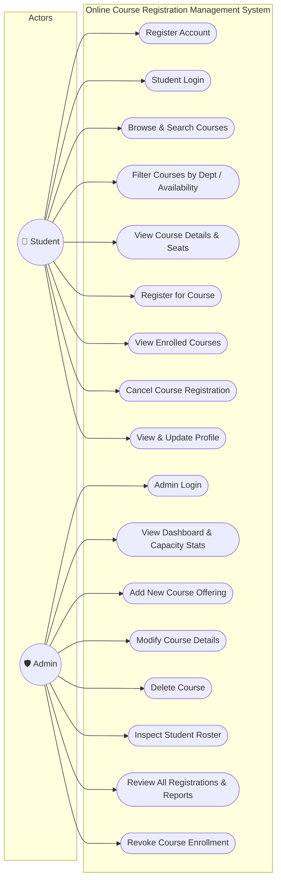

---

### 2. Use Case Package Diagram

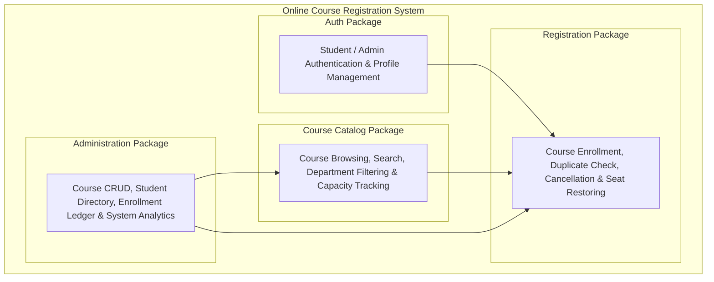

---

### 3. Domain Class Diagram

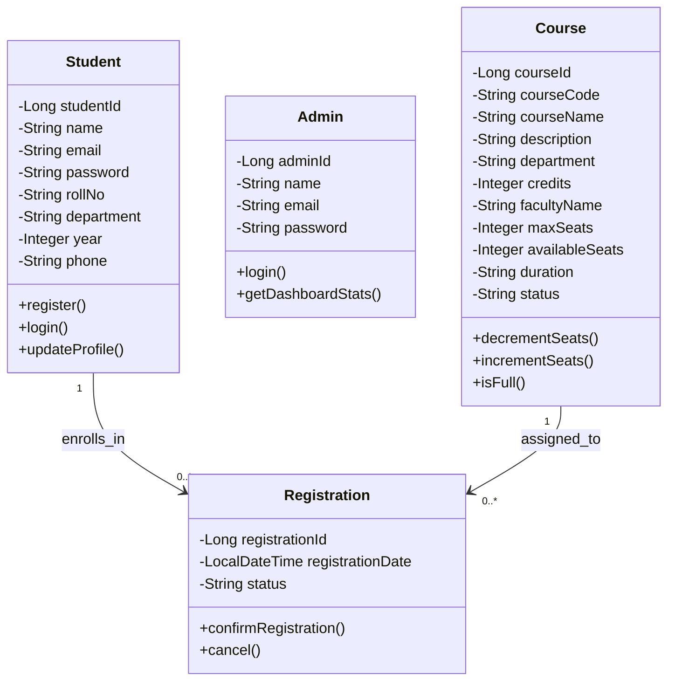

---

### 4. High-Level Sequence Diagram (Student Course Registration)

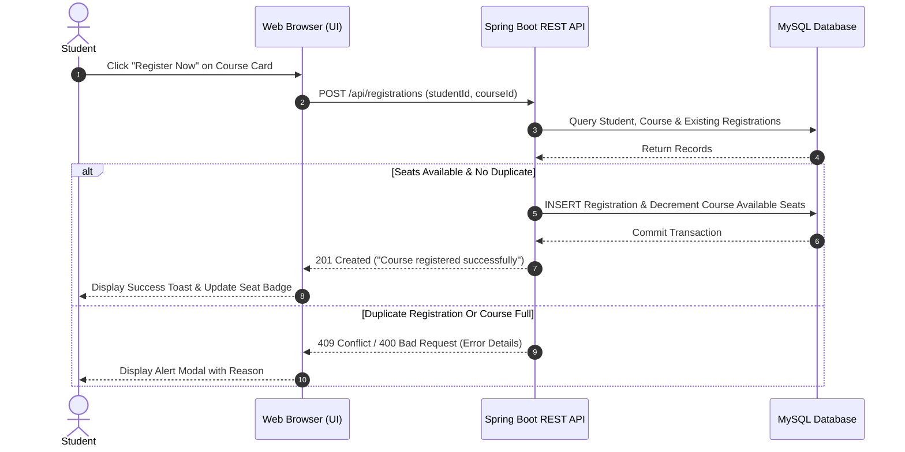

---

### 5. Detailed Sequence Diagram (Course Registration with Seat Validation)

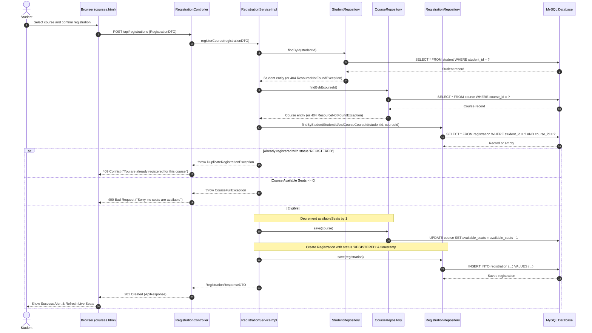

---

### 6. High-Level Communication Diagram (Course Registration Flow)

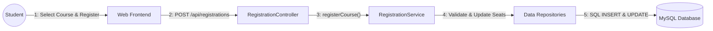

---

### 7. Detailed Communication Diagram (Cancellation / Drop Course)

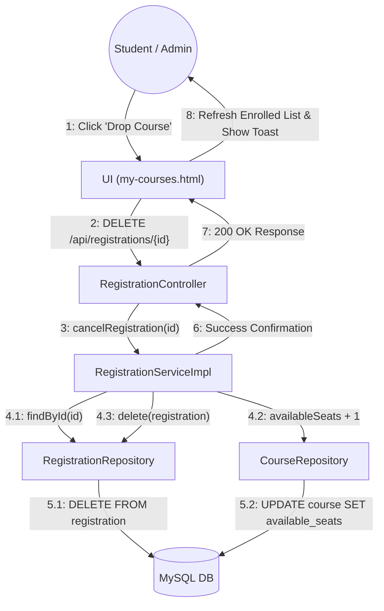

---

### 8. Activity Diagram (Student Course Registration Flow)

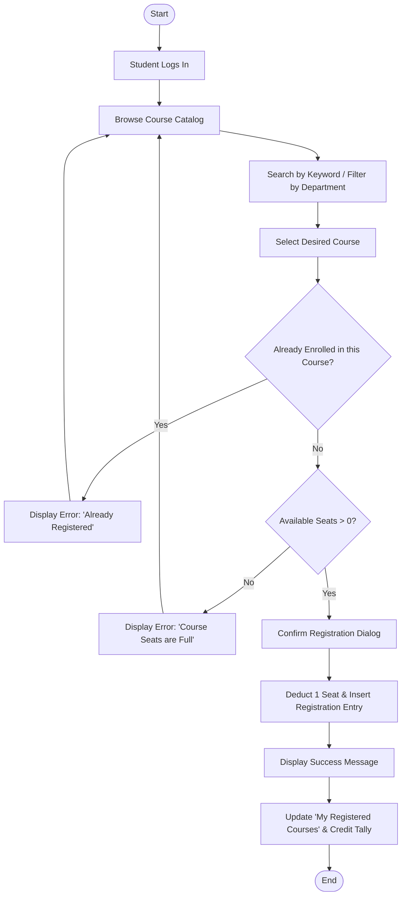

---

### 9. Component Diagram

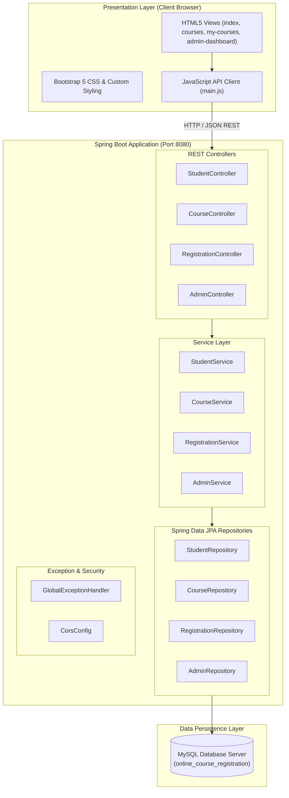

---

### 10. Deployment Diagram

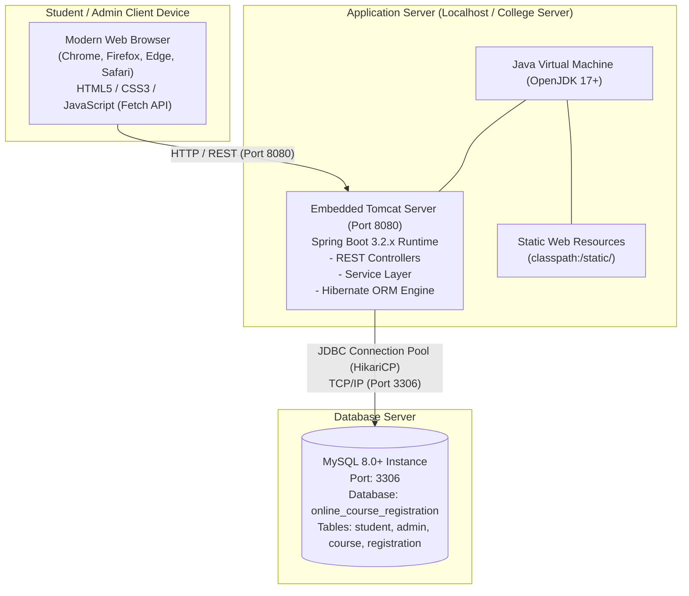

---

### 11. Entity-Relationship (ER) Diagram

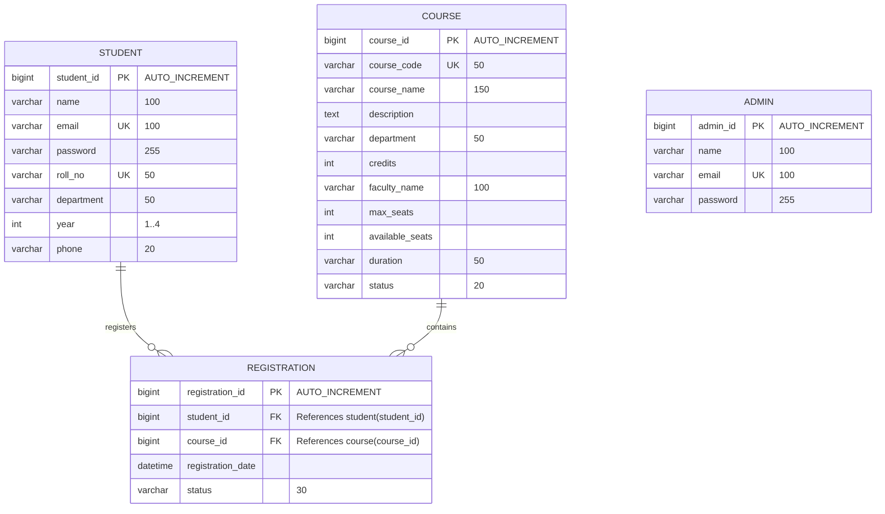

---

### 12. Project Layered Architecture Diagram

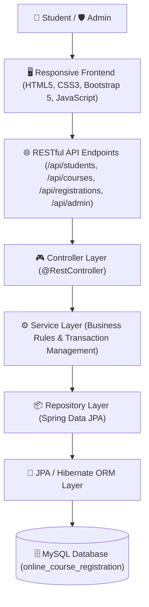

---

### 13. System Workflow Diagrams

#### Student Workflow
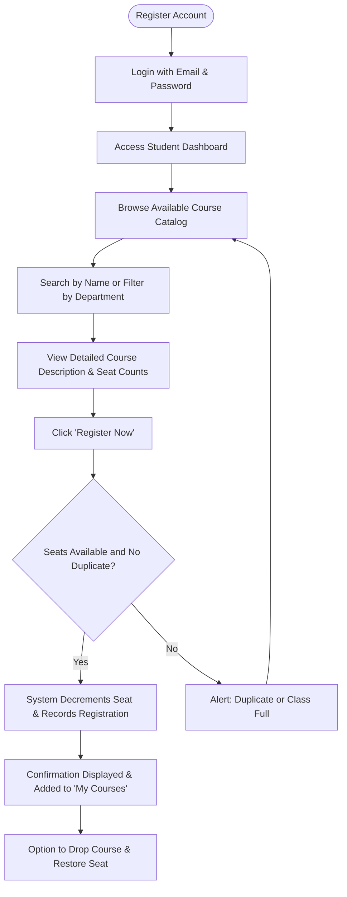

#### Admin Workflow
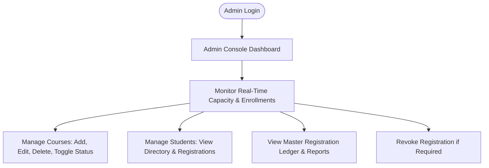
